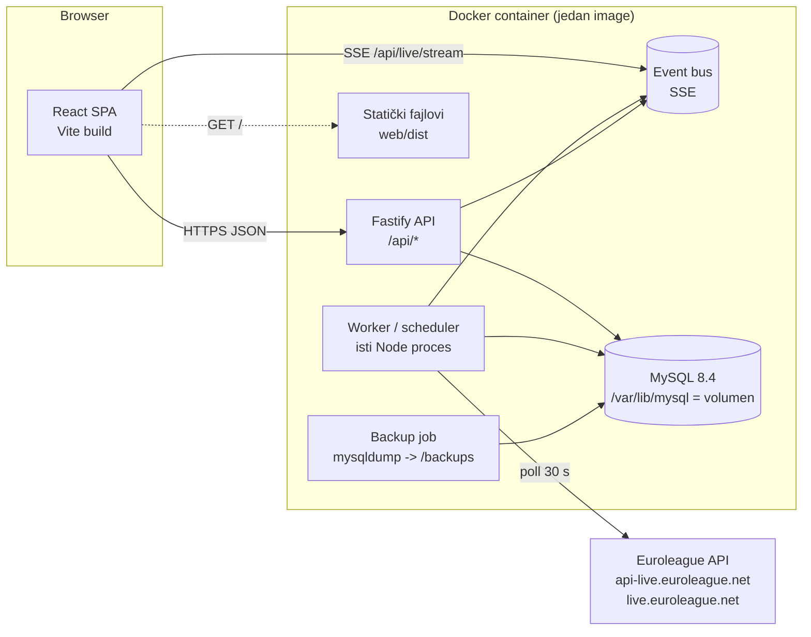

# Dizajn — Veseli četvrtak

**Izvor:** `docs/requirements.md` (REQ-01…REQ-38), `docs/specifikacija/`
**Datum:** 14.10.2026.

## 1. Tehnološke odluke

| Oblast | Izbor | Obrazloženje |
|--------|-------|--------------|
| Jezik | **TypeScript** (backend i frontend) | Zajednički tipovi API-ja (`server/src/api-types.ts`), manje grešaka u pravilima igre. |
| Backend | **Fastify 5** | Brži i manji od Express-a, ugrađena validacija šema (JSON Schema), pluginovi za kolačiće, multipart i statičke fajlove, `inject()` za testove bez otvaranja porta. |
| Pristup bazi | **Kysely** + `mysql2` | Tipiziran SQL graditelj upita bez "magije" ORM-a; migracije u kodu; parametrizovani upiti (REQ-36). |
| Baza | **MySQL 8.4** | Zahtev naručioca. |
| Vreme | **Luxon** | Pouzdan rad sa zonom Europe/Belgrade (dan kola, sezona). |
| Validacija spoljnog API-ja | **Zod** | Odbacivanje neočekivanih odgovora (REQ-33.5). |
| Lozinke | **bcryptjs** | Čist JS, bez nativnog build-a u Docker-u. |
| XLSX | **SheetJS (xlsx 0.20.3, cdn.sheetjs.com)** | Čita i XLS i XLSX, samo vrednosti ćelija (REQ-31, NFR-24). |
| Frontend build | **Vite** | Brz dev server i build; jednostavno služenje statičkih fajlova iz Fastify-ja. |
| Stanje / fetch | **TanStack Query** + **React Router** | Keš serverskog stanja, invalidacija na SSE događaj; bez globalnog store-a. |
| Live ka klijentu | **Server-Sent Events** | Jednosmerni tok je dovoljan; radi kroz proxy-je; automatsko ponovno povezivanje u browseru. |
| Testovi | **Vitest** (+ `mysql-memory-server` za integracione testove, Testing Library za UI) | Isti alat za server i web; prava MySQL instanca u testovima bez Docker-a. |
| Kontejner | Jedan image: `mysql:8.4` + Node 22 binarni fajl | MySQL zvanično, Node kopiran iz `node:22-bookworm-slim`. |
| Hosting | Oracle Cloud Always Free VM (ARM Ampere ili AMD) | Stalno uključena, trajni disk (OQ-01, OQ-02). |

## 2. Arhitektura



- Jedan Node proces pokreće HTTP server i scheduler (`server/src/index.ts`). Worker je odvojen modul, testabilan sa lažnim provajderom.
- MySQL radi u istom kontejneru (pokreće ga `docker/entrypoint.sh`); podaci na volumenu `/var/lib/mysql`, backup na `/backups`.
- Klijent nikad ne zove spoljni API (REQ-13.10).

## 3. Struktura repozitorijuma

```
package.json            npm workspaces: server, web
server/
  src/
    index.ts            start: migracije -> seed -> HTTP -> scheduler
    app.ts              buildApp(deps): Fastify instanca (koristi se i u testovima)
    config.ts           env promenljive
    api-types.ts        DTO tipovi koje deli i frontend
    db/                 kysely.ts, schema.ts, migrations/, migrate.ts, seed.ts
    domain/             čista pravila igre (bez I/O)
    services/           poslovna logika nad bazom
    provider/           EuroleagueProvider + implementacije
    worker/             scheduler i poslovi
    routes/             HTTP rute
    live/               event bus za SSE
  test/                 unit, integration, fixtures (snimljeni JSON odgovori API-ja)
web/
  src/                  api/, components/, pages/, hooks/, styles/
Dockerfile, docker/entrypoint.sh, deploy/
```

## 4. Model podataka (MySQL)

Sva vremena su `DATETIME` u **UTC**; `game_day` je `DATE` po zoni Europe/Belgrade. Iznosi `DECIMAL(12,2)`, kvote `DECIMAL(8,2)`, granica `DECIMAL(5,1)`.

| Tabela | Ključne kolone |
|--------|----------------|
| `members` | `id` TINYINT PK, `name`, `display_name`, `avatar_url`, `username` UNIQUE, `password_hash`, `must_change_password`, `is_admin`, `sort_order`, `failed_attempts`, `locked_until` |
| `sessions` | `id` CHAR(64) PK (SHA-256 tokena), `member_id`, `expires_at`, `created_at` |
| `seasons` | `code` PK (`E2026`), `name`, `start_date` |
| `clubs` | `code` PK, `name`, `short_name`, `crest_url` |
| `players` | `id` PK, `external_code` UNIQUE NULL, `first_name`, `last_name`, `full_name`, `search_name` (bez dijakritika, mala slova), `club_code`, `position`, `jersey`, `photo_url`, `is_active`, `is_manual`, `last_synced_at` |
| `games` | `id` PK, `season_code`, `game_code`, UNIQUE(`season_code`,`game_code`), `euroleague_round`, `home_club_code`, `away_club_code`, `scheduled_at`, `game_day`, `status` ENUM(`scheduled`,`live`,`final`,`postponed`,`cancelled`), `home_score`, `away_score`, `live_quarter`, `live_clock`, `started_at`, `final_at`, `recheck_done_at`, `last_polled_at`, `is_manual` |
| `player_game_stats` | PK(`game_id`,`player_id`), `points`, `seconds_played`, `fouls`, `is_final`, `updated_at` |
| `rounds` | `id` PK, `number` UNIQUE, `opened_at`, `game_day`, `season_code`, `euroleague_round`, `source` ENUM(`app`,`import`), `status` ENUM(`open`,`locked`,`in_progress`,`won`,`lost`,`void`), `stake`, `total_odds`, `payer_member_id`, `actual_win`, `actual_win_provisional`, `actual_win_manual`, `hits`, `misses`, `voids`, `locked_at`, `locked_by`, `resolved_at`, `has_corrections` |
| `picks` | `id` PK, `round_id`, `slot` 1–4, UNIQUE(`round_id`,`slot`), `kind` ENUM(`personal`,`team`), `member_id` (lični), `cooldown_for_member_id` (tip ekipe), `player_id`, UNIQUE(`round_id`,`player_id`), `game_id`, `line`, `direction` ENUM(`over`,`under`), `odds`, `final_points`, `result` ENUM(`hit`,`miss`,`void`), `void_reason` ENUM(`dnp`,`game_not_played`), `resolution` ENUM(`auto`,`manual`,`import`), `resolved_at`, `import_player_name` |
| `proposals` | `id` PK, `round_id`, `proposed_by`, `kind`, `cooldown_for_member_id`, `player_id`, `line`, `direction`, `comment`, `status` ENUM(`pending`,`accepted`,`rejected`,`superseded`), `created_at` |
| `proposal_votes` | PK(`proposal_id`,`member_id`) |
| `audit_log` | `id` PK, `at`, `actor_member_id` NULL (= sistem), `action`, `round_id`, `entity`, `entity_id`, `field`, `old_value` JSON, `new_value` JSON, `reason` |
| `sync_runs` | `id` PK, `type`, `started_at`, `finished_at`, `status`, `error_message`, `items_changed` |

**Odstupanje od modela iz specifikacije (svesno):** `MEMBER_ROUND_STATE` se ne čuva u bazi. Izvedeno stanje (nizovi, ❄, 🔥, blejm) računa čista funkcija `computeDerived()` nad svim razrešenim kolima (≤ 500 kola × 4 tipa — milisekunde) i drži se u memorijskom kešu koji se poništava pri svakoj izmeni kola. Time je rekalkulacija od nule uvek istovetna inkrementalnoj (REQ-23.4) po konstrukciji. Zadaci admina (REQ-32) se takođe izvode iz stanja, ne čuvaju se.

## 5. Domen (čista pravila, `server/src/domain`)

| Funkcija | Pravila | Opis |
|----------|---------|------|
| `isValidLine(line)` | BR-09 | `line > 0` i `line mod 1 = 0,5` |
| `resolvePick(direction, line, points, secondsPlayed)` | BR-12, BR-13 | `hit` / `miss` / `void(dnp)` |
| `liveStatus(...)` | BR-16, FR-13 | `not_started`, `passing`, `failing`, `sure_hit`, `sure_miss`, `not_entered`, `final_hit`, `final_miss`, `void` + `pointsNeeded` |
| `ticketOutcome(results[])` | BR-17, BR-19 | status (`won`/`lost`/`void`/`pending`), `hits`, `misses`, `voids`, oznaka `3/4` ili `3/3 (+1)` |
| `computeActualWin(stake, totalOdds, picks)` | BR-18 | iznos ili `null` + `provisional` kada fale pojedinačne kvote |
| `seasonForDate(day)` | BR-33 | `E{godina}` ako je mesec ≥ 7, inače `E{godina-1}` |
| `computeDerived(rounds)` | BR-20…BR-26, BR-30, BR-33 | po kolu i članu: niz, ❄, 🔥, blejm; očekivano hlađenje za sledeće kolo; nekonzistentnosti |
| `normalizeName(s)` | FR-06 KP1 | mala slova, bez dijakritika (uključujući đ→dj) |

Pravila `computeDerived` (hronološki po `number`, samo razrešena kola):
1. Pri promeni sezone: svi nizovi = 0, vatrica = ne, zakazano hlađenje = ne.
2. Član je "na hlađenju" u kolu ako je u tom kolu njegov slot tipa ekipe (`cooldown_for_member_id`). Na kraju takvog kola: niz promašaja = 0.
3. Lični `hit`: niz pogodaka +1, niz promašaja 0; kada niz pogodaka postane tačno 3 → vatrica + brojač vatrica +1. Lični `miss`: niz promašaja +1, niz pogodaka 0, vatrica nestaje; kada niz promašaja postane 5 → hlađenje u sledećem kolu (brojač hlađenja +1 kada se odsluži). `void`: bez promene.
4. Blejm: status `lost` i tačno 1 `miss` → član tog slota ili `team`.
5. Očekivano hlađenje za kolo N+1 = članovi kojima je posle kola N niz promašaja = 5 (u istoj sezoni). Ako stvarni sastav kola N+1 odstupa → `cooldownInconsistent`.

## 6. API (prefiks `/api`, JSON)

Autentifikacija: kolačić `vc_session` (HttpOnly, Secure u produkciji, SameSite=Lax). Mutacije zahtevaju zaglavlje `X-Requested-With: vc` (CSRF zaštita uz SameSite). Greške: `{ error: { code, message } }` sa kodovima 400/401/403/404/409/422.

| Metod i putanja | Ko | Opis |
|-----------------|----|------|
| `POST /auth/login` · `POST /auth/logout` · `GET /auth/me` · `POST /auth/change-password` | svi / član | REQ-01 |
| `GET /members` | svi | članovi + ❄/🔥/niz |
| `PATCH /members/:id` · `POST /members/:id/transfer-admin` · `POST /members/:id/reset-password` | admin | REQ-03, REQ-01 |
| `GET /players/search?q=&day=` | svi | autocomplete (REQ-07) |
| `POST /players` | admin | ručni igrač |
| `GET /games/days` · `GET /games?day=` · `POST /games` | svi / admin | dani sa utakmicama, ručna utakmica |
| `GET /rounds?…filteri…&page=` | svi | istorija (REQ-27) |
| `GET /rounds/current` · `GET /rounds/:id` | svi | detalj + live (REQ-28) |
| `POST /rounds` `{gameDay}` | admin | novo kolo (REQ-06) |
| `PATCH /rounds/:id` `{gameDay?, stake?, totalOdds?, payerMemberId?}` | admin | otvoreno kolo |
| `PUT /rounds/:id/picks/:slot` `{playerId, line, direction, odds?}` · `DELETE …` | admin | tip (REQ-08) |
| `POST /rounds/:id/lock` · `POST /rounds/:id/unlock {reason}` | admin | REQ-11, REQ-12 |
| `POST /rounds/:id/corrections` `{slot?, field, value, reason, dryRun?}` | admin | ciljana ispravka + pregled posledica |
| `POST /rounds/:id/picks/:slot/resolve` `{mode: points\|dnp\|not_played, points?, reason}` | admin | REQ-16 |
| `POST /rounds/:id/actual-win` `{amount, reason}` | admin | REQ-15.8 |
| `DELETE /rounds/:id` `{confirmNumber}` | admin | REQ-30 |
| `POST /rounds/:id/proposals` · `POST /proposals/:id/vote` · `DELETE /proposals/:id/vote` · `POST /proposals/:id/accept` | član / admin | REQ-09, REQ-19 |
| `GET /stats/overview` · `GET /stats/members` · `GET /stats/members/:id` · `GET /stats/blame` (`?season=&from=&to=`) | svi | REQ-24…REQ-26 |
| `GET /audit?roundId=&actor=` | član | REQ-29 |
| `GET /admin/tasks` · `GET /admin/sync-runs` · `POST /admin/sync/players` · `POST /admin/sync/schedule` · `POST /admin/recalc` | admin | REQ-32, REQ-04 |
| `GET /import/template` · `POST /import/preview` (multipart) · `POST /import/commit` | admin | REQ-31 |
| `GET /live/stream` | svi | SSE: `round` `{roundId}` (invalidacija), `live` `{roundId, picks}`, `ping` |
| `GET /health` | — | provera za Docker |

## 7. Integracija sa Euroleague API-jem

Provereno 14.10.2026. (snimci u `server/test/fixtures`):

| Namena | Endpoint | Ključna polja |
|--------|----------|---------------|
| Raspored sezone | `GET https://api-live.euroleague.net/v2/competitions/E/seasons/{season}/games` | `gameCode`, `round`, `utcDate`, `local.club.code`, `road.club.code`, `played`, `local.score`, `road.score` |
| Igrači sezone | `GET https://api-live.euroleague.net/v2/competitions/E/seasons/{season}/people?personType=J` | `person.code`, `person.name` ("PREZIME, IME"), `club.code/name`, `positionName`, `dorsal`, `images.headshot`, `active` |
| Zaglavlje utakmice | `GET https://live.euroleague.net/api/Header?gamecode={n}&seasoncode={season}` | `Live`, `ScoreA/B`, `Quarter`, `RemainingPartialTime` |
| Boxscore | `GET https://live.euroleague.net/api/Boxscore?gamecode={n}&seasoncode={season}` | `Live`, `Stats[].PlayersStats[]`: `Player_ID` ("P" + `person.code`, sa razmacima), `Minutes` ("MM:SS" ili "DNP"), `Points`, `FoulsCommited` |

Interfejs `EuroleagueProvider { listGames(season), listPlayers(season), getHeader(season, gameCode), getBoxscore(season, gameCode) }` vraća normalizovane tipove; `EuroleagueLiveProvider` (fetch + Zod + timeout 10 s + `User-Agent`), `FakeProvider` za testove. Završetak utakmice: `Header.Live === false`, rezultat > 0 i bar 90 min od početka (ili `played: true` u rasporedu).

## 8. Pozadinski poslovi (`server/src/worker`)

Scheduler "tick" na 30 s; svaki posao ima uslov pokretanja i zaštitu od preklapanja.

| Posao | Kada | Radi |
|-------|------|------|
| `syncSchedule` | dnevno 04:00, na dan kola na 15 min, na zahtev | upsert `games`; utakmica pomerena sa dana kola → tip `void(game_not_played)` |
| `syncPlayers` | dnevno 04:30, na zahtev | upsert `players`, `clubs`; nestali → `is_active = 0` |
| `autoLock` | svaki tick | kompletno otvoreno kolo kome je počela prva utakmica → `locked` (akter "sistem") |
| `livePoll` | svaki tick, utakmice aktivnog kola od −10 min do kraja | Header + Boxscore → `games`, `player_game_stats`, SSE `live`; status kola `in_progress` |
| `finalize` | posle `livePoll` | završena utakmica → razrešenje tipova, tiketa, invalidacija izvedenog stanja |
| `resolvePending` | svaki tick | završene utakmice čiji su tipovi ostali nerazrešeni (npr. pad procesa) → ponovno razrešenje |
| `notPlayed` | svaki tick | dan kola prošao (06:00 sledećeg dana), utakmica nije počela → `void(game_not_played)` |
| `recheck` | 12 h posle `final_at` | ponovni boxscore; promena ishoda → ispravka + audit |
| `backup` | dnevno 03:00 (samo u kontejneru) | `mysqldump` → `/backups/vc-YYYYMMDD.sql.gz`, čuva 30 |

Pri pokretanju procesa poslovi nastavljaju od stanja u bazi (REQ-38.6).

## 9. Frontend

Rute: `/` Početna · `/kolo` aktuelno kolo (unos ili live) · `/kolo/:id` detalj · `/istorija` · `/statistika` · `/clanovi` i `/clanovi/:id` · `/blejm` · `/audit` · `/podesavanja` · `/zadaci` · `/prijava`.
- Donja navigacija na telefonu (Početna, Kolo, Istorija, Statistika, Još), bočna na desktopu.
- `useLiveStream()` otvara SSE i na događaj poziva `queryClient.invalidateQueries`/`setQueryData`.
- Gost vidi sve osim `/audit`, `/podesavanja`, `/zadaci`; akcije zamenjuje dugme "Prijavi se".
- Formatiranje: `sr-Latn-RS`, `1.250,00 RSD`, `dd.MM.yyyy.`, Europe/Belgrade.
- Bez UI biblioteke: sopstveni CSS (CSS promenljive, mobile-first), da bundle ostane mali.

## 10. Bezbednost

- Lozinke bcrypt (cost 12); početne lozinke iz `INITIAL_PASSWORD` ili generisane i ispisane jednom u log; obavezna promena pri prvoj prijavi.
- Sesije: nasumičan 32-bajtni token u kolačiću, u bazi samo SHA-256; trajanje 30 dana.
- Ograničenje pokušaja prijave (5 / 15 min po nalogu).
- Sve rute imaju JSON šemu ulaza; autorizacija preko `preHandler` hook-ova (`requireMember`, `requireAdmin`).
- Zaglavlja: `@fastify/helmet` (CSP self), `X-Robots-Tag: noindex`.
- HTTPS: Caddy na VM-u ispred kontejnera (automatski Let's Encrypt), vidi `deploy/README.md`.

## 11. Isporuka

- `Dockerfile` (multi-stage): `node:22-bookworm-slim` build → `mysql:8.4` runtime + Node binarni fajl.
- `docker/entrypoint.sh`: inicijalizuje i pokreće `mysqld` u pozadini, čeka da bude spreman, kreira bazu/korisnika, pokreće Node (migracije + seed), prosleđuje SIGTERM oba procesa.
- Volumeni: `/var/lib/mysql`, `/backups`. Port 8080. Restart politika `unless-stopped`.
- `deploy/`: uputstvo za Oracle Cloud Always Free VM, `deploy.sh` (rsync + `docker build` + `docker run` na VM-u), Caddyfile, cron za kopiranje backup-a van VM-a.
