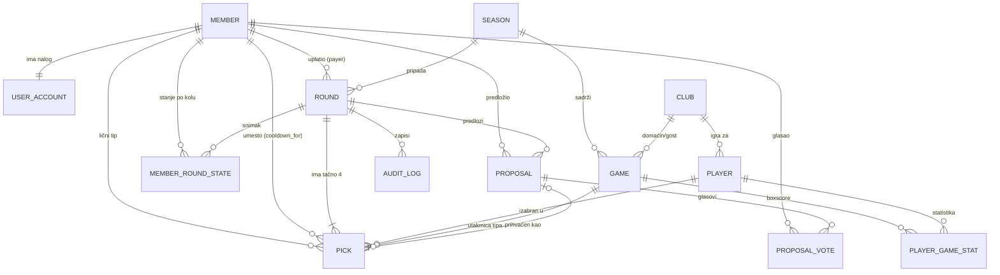

# 6. Model podataka

Logički model (nezavisan od konkretne baze). Imena entiteta i atributa su na engleskom radi direktne upotrebe u kodu; opisi su na srpskom.
Konvencije: svaki entitet ima `id` (UUID) i `created_at` / `updated_at` (UTC) osim ako nije drugačije navedeno. Iznosi su `decimal(12,2)`, kvote `decimal(8,2)`, granice `decimal(5,1)`.

## 6.1 ER dijagram

## 6.2 Entiteti

### MEMBER (Član tima)
| Atribut | Tip | Opis |
|---------|-----|------|
| id | UUID | |
| name | string | Ivanišević / Tozislav / Lakićević / Simara (fiksno, BR-01) |
| display_name | string | prikazno ime/nadimak |
| avatar_url | string? | |
| is_admin | bool | tačno jedan `true` (BR-32) |
| sort_order | int | redosled prikaza na tiketu |

### USER_ACCOUNT (Nalog)
| Atribut | Tip | Opis |
|---------|-----|------|
| id | UUID | |
| member_id | FK → MEMBER | 1:1 |
| email | string | jedinstven |
| password_hash | string? | ako se koristi lozinka |
| last_login_at | datetime? | |
| failed_attempts, locked_until | int, datetime? | FR-01 KP2 |

### SEASON (Sezona)
| Atribut | Tip | Opis |
|---------|-----|------|
| code | string, PK | npr. `E2026` |
| name | string | "2026/27" |
| is_current | bool | |

### CLUB (Klub Evrolige)
| Atribut | Tip | Opis |
|---------|-----|------|
| id | UUID | |
| external_code | string | kod kluba u API-ju (npr. `PAR`, `RED`) |
| name, short_name | string | |
| logo_url | string? | |

### PLAYER (Igrač Evrolige)
| Atribut | Tip | Opis |
|---------|-----|------|
| id | UUID | |
| external_id | string? | ID osobe u API-ju (npr. `P003733`); null za ručno dodate |
| first_name, last_name | string | |
| search_name | string | normalizovano ime bez dijakritika, mala slova (FR-06 KP1) |
| club_id | FK → CLUB | trenutni klub |
| position | enum? | Guard / Forward / Center |
| jersey_number | string? | |
| photo_url | string? | |
| is_active | bool | FR-03 |
| is_manual | bool | ručno dodat (FR-03 KP3) |
| last_synced_at | datetime? | |

### GAME (Utakmica)
| Atribut | Tip | Opis |
|---------|-----|------|
| id | UUID | |
| season_code | FK → SEASON | |
| game_code | int | ID utakmice u sezoni (API) |
| euroleague_round | int? | kolo Evrolige |
| home_club_id, away_club_id | FK → CLUB | |
| scheduled_at | datetime | planirani početak |
| original_scheduled_at | datetime | prvi poznati termin (BR-14) |
| status | enum | `scheduled`, `live`, `final`, `postponed`, `cancelled` |
| home_score, away_score | int? | |
| live_quarter, live_clock | string? | za live prikaz |
| final_at | datetime? | kada je API označio kraj |
| recheck_done_at | datetime? | ponovna provera posle 12 h (BR-15) |
| last_polled_at | datetime? | |
Jedinstvenost: (`season_code`, `game_code`).

### PLAYER_GAME_STAT (Boxscore red)
| Atribut | Tip | Opis |
|---------|-----|------|
| id | UUID | |
| game_id | FK → GAME | |
| player_id | FK → PLAYER | |
| points | int | |
| seconds_played | int | 0 = nije ušao (BR-13) |
| fouls | int? | |
| is_final | bool | podaci posle kraja utakmice |
| updated_at | datetime | |
Jedinstvenost: (`game_id`, `player_id`). Čuvaju se samo igrači koji su izabrani u nekom tipu (radi uštede), osim ako se drugačije odluči.

### ROUND (Kolo)
| Atribut | Tip | Opis |
|---------|-----|------|
| id | UUID | |
| number | int, jedinstven | automatski (BR-03) |
| opened_at | datetime | automatski (BR-04) |
| game_day | date | dan kola (BR-07); sve utakmice tipova su tog dana |
| season_code | FK → SEASON | određuje se iz `game_day`; granica za reset nizova (BR-33) |
| euroleague_round | int? | informativno, automatski (BR-07) |
| source | enum | `app` / `import` (BR-34, FR-25) |
| status | enum | `open`, `locked`, `in_progress`, `won`, `lost`, `void` |
| stake | decimal | uplata (RSD) |
| total_odds | decimal | ukupna kvota |
| payer_member_id | FK → MEMBER | uplatilac |
| potential_win | decimal | izvedeno: stake × total_odds (BR-11) |
| actual_win | decimal? | stvarni dobitak (BR-18) |
| actual_win_is_provisional | bool | FR-14 KP3 |
| actual_win_manual | bool | ručno korigovan |
| hits, misses, voids | int | izvedeno, za brz prikaz ishoda k/n |
| locked_at | datetime? | |
| locked_by | FK → MEMBER? | null = sistem |
| resolved_at | datetime? | |
| has_corrections | bool | FR-12 KP3 |
| cooldown_inconsistent | bool | BR-30 |

### PICK (Tip)
| Atribut | Tip | Opis |
|---------|-----|------|
| id | UUID | |
| round_id | FK → ROUND | |
| kind | enum | `personal` (lični) / `team` (tip ekipe) |
| member_id | FK → MEMBER? | autor ličnog tipa; null za tip ekipe |
| cooldown_for_member_id | FK → MEMBER? | samo za `team`: umesto koga |
| player_id | FK → PLAYER | |
| game_id | FK → GAME? | obavezno za `source = app`; može biti null za uvezena kola |
| line | decimal | granica, uvek x,5 (BR-09); izuzetak su uvezena kola |
| direction | enum | `over` (više) / `under` (manje) |
| odds | decimal? | pojedinačna kvota |
| final_points | int? | konačni poeni |
| result | enum? | `hit`, `miss`, `void`; null dok nije razrešen |
| void_reason | enum? | `dnp`, `game_not_played` (odložena/otkazana, BR-14) |
| resolution | enum? | `auto` / `manual` / `import` |
| resolved_at | datetime? | |
| source_proposal_id | FK → PROPOSAL? | ako je nastao iz predloga |
Ograničenja: tačno 4 tipa po kolu; (`round_id`, `member_id`) jedinstveno za lične; (`round_id`, `player_id`) jedinstveno (BR-06); `kind = personal` ⇔ `member_id` nije null.

### PROPOSAL (Predlog tipa) i PROPOSAL_VOTE (Glas)
| Atribut | Tip | Opis |
|---------|-----|------|
| id | UUID | |
| round_id | FK → ROUND | |
| proposed_by | FK → MEMBER | |
| kind | enum | `personal` (FR-09) / `team` (FR-08) |
| cooldown_for_member_id | FK → MEMBER? | za `team` |
| player_id, game_id, line, direction | | kao u PICK |
| comment | string? | |
| status | enum | `pending`, `accepted`, `rejected`, `superseded` |

PROPOSAL_VOTE: `proposal_id`, `member_id`, `created_at`; jedinstveno (`proposal_id`, `member_id`).

### MEMBER_ROUND_STATE (Snimak stanja člana posle kola — izvedeno)
Keš rezultata rekalkulacije (FR-16); može se u svakom trenutku obrisati i izračunati ponovo (BR-30).
| Atribut | Tip | Opis |
|---------|-----|------|
| member_id, round_id | FK | jedinstveno zajedno |
| season_code | FK → SEASON | nizovi se računaju unutar sezone (BR-33) |
| was_on_cooldown | bool | član bio na hlađenju u ovom kolu |
| pick_result | enum? | `hit`/`miss`/`void`/null |
| hit_streak, miss_streak | int | stanje niza posle kola |
| has_fire | bool | aktivna vatrica posle kola |
| fire_gained, fire_lost | bool | promena u ovom kolu |
| cooldown_next_round | bool | ide na hlađenje u sledećem kolu |
| is_blame | bool | blejm u ovom kolu |
| total_hits, total_misses, total_voids, total_blames, total_cooldowns, total_fires | int | kumulativno |
| longest_hit_streak, longest_miss_streak | int | najduži nizovi u sezoni |
| total_* | | kumulativni brojači vode se i po sezoni i ukupno (FR-18 KP3) |

### AUDIT_LOG
| Atribut | Tip | Opis |
|---------|-----|------|
| id | UUID | |
| at | datetime | |
| actor_member_id | FK → MEMBER? | null = sistem |
| action | enum | `lock`, `auto_lock`, `unlock`, `correct`, `manual_resolve`, `auto_recheck_fix`, `actual_win_override`, `admin_transfer`, `round_delete`, `full_recalc`, `history_import` |
| round_id | FK → ROUND? | |
| entity, entity_id, field | string | |
| old_value, new_value | json | |
| reason | string | obavezno za ručne akcije |
Samo dodavanje (append-only), bez izmene i brisanja (FR-22).

### SYNC_RUN (Evidencija sinhronizacija)
`id`, `type` (`players`, `schedule`, `live`, `final`, `recheck`), `started_at`, `finished_at`, `status` (`ok`/`error`), `error_message`, `items_changed`. Koristi se za upozorenja o zastarelim podacima (FR-03 KP2, FR-13 KP2).

## 6.3 Ključne veze i pravila integriteta
- ROUND 1 — 4 PICK (BR-02); broj tipova `team` u kolu = broj članova na hlađenju.
- PICK → GAME → (home/away CLUB); igrač tipa mora pripadati jednom od klubova utakmice u trenutku unosa, a `GAME.scheduled_at` mora pasti na `ROUND.game_day` (BR-07).
- Granica: `line mod 1 = 0,5` za kola sa `source = app` (BR-09).
- Statistike (FR-17…FR-19) računaju se iz PICK/ROUND, a MEMBER_ROUND_STATE je samo keš.
- Brisanje: dozvoljeno samo za ROUND u statusu `open` (FR-24), kaskadno sa PICK/PROPOSAL; PLAYER i GAME se nikad ne brišu fizički.
